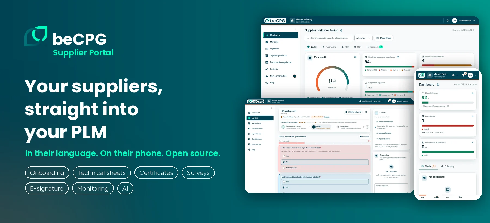
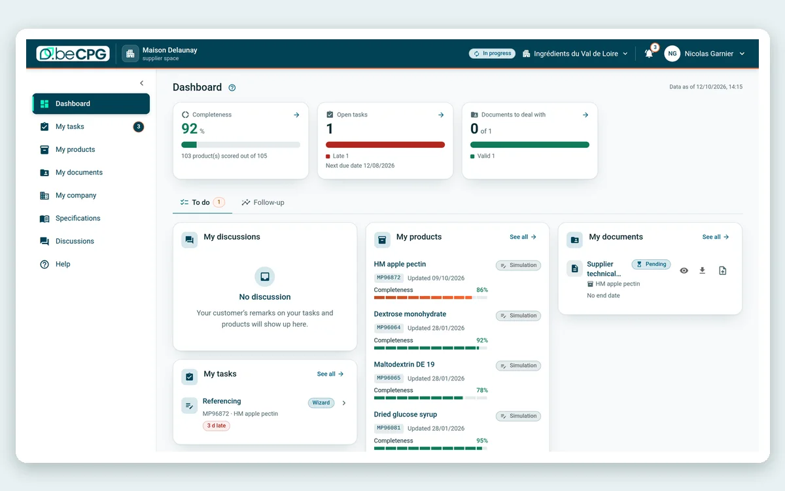
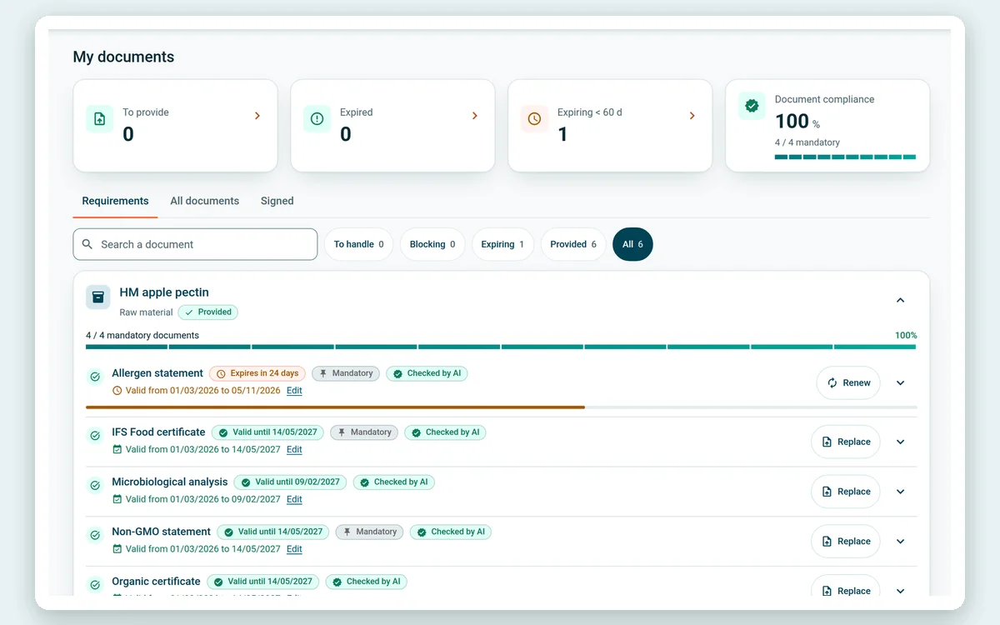
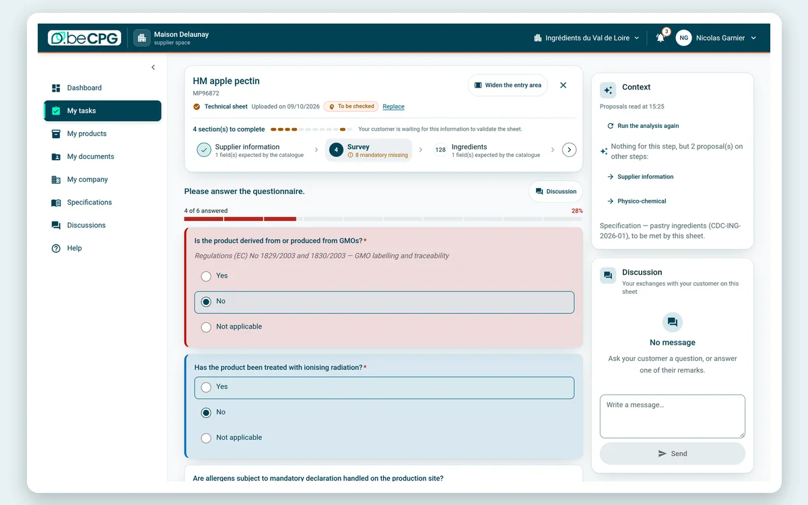
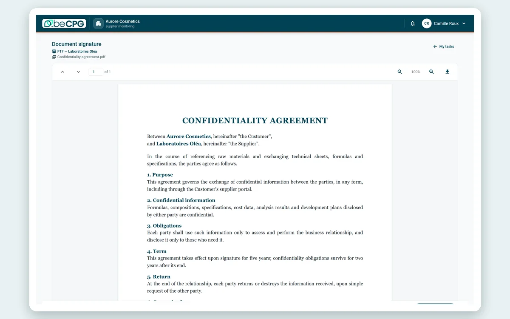
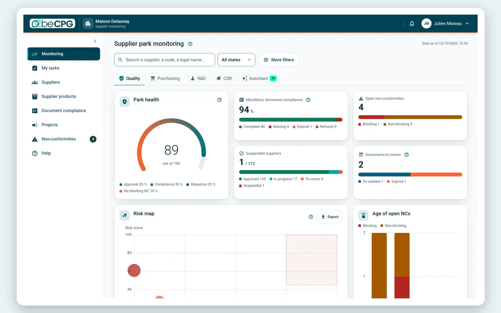
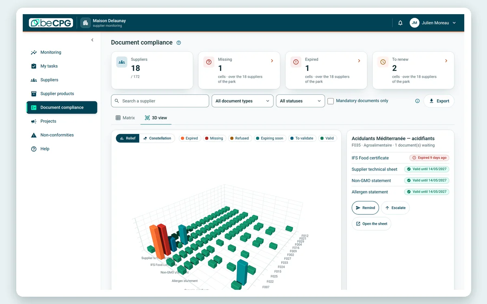

<div align="center">



[](https://www.gnu.org/licenses/lgpl-3.0)
[](https://www.becpg.net/plm-software/suppliers-portal/)
[](https://nextjs.org/)
[](https://nodejs.org/)
[](docker-compose.yml)
[](https://github.com/becpg/becpg-supplier-portal/issues)
[](https://www.becpg.net/docs/en/)
[](https://www.becpg.net)

[Website](https://www.becpg.net/plm-software/suppliers-portal/) · [Documentation](https://www.becpg.net/docs/en/) · [Free trial](https://www.becpg.net/contact-us/#trial) · [Book a demo](https://www.becpg.net/contact-us/#demo)

</div>

<sub>Screenshots from a demo instance; brand, supplier, product and people names are fictitious, and figures are demonstration data.</sub>

---

Every year, a quality team chases the same documents: an IFS certificate that expired last week, a technical sheet in the wrong template, an allergen statement nobody can find. The answers come back by email, in PDF, and someone types them into the PLM.

The beCPG Supplier Portal turns that chase into a task list on the supplier's side. Each supplier signs in, sees what you expect from them and by when, fills in the sheet against your own data model, uploads the documents and signs the agreements. What they submit is the PLM record itself: there is nothing to import afterwards. Your quality and purchasing teams follow the whole supplier park from one monitoring space.

It is the supplier-facing side of [beCPG PLM](https://github.com/becpg/becpg-community), the open source PLM for food, beverage and cosmetics.

## See it

<table>
<tr>
<td width="33%"><br><b>Supplier dashboard</b><br><sub>What to complete, what is late, what is about to expire.</sub></td>
<td width="33%"><br><b>Documents</b><br><sub>Every certificate your PLM requires, with its validity and the upload button right there.</sub></td>
<td width="33%"><br><b>Guided wizard</b><br><sub>Steps and fields come from your beCPG configuration: a new field needs no release.</sub></td>
</tr>
<tr>
<td width="33%"><br><b>Electronic signature</b><br><sub>Agreements read and signed in the portal, stored back in the PLM.</sub></td>
<td width="33%"><br><b>Park monitoring</b><br><sub>Approvals, compliance and non-conformities across all suppliers, computed live.</sub></td>
<td width="33%"><br><b>Document compliance</b><br><sub>Supplier by supplier and document by document, as a matrix or in 3D.</sub></td>
</tr>
</table>

## At a glance

| | |
| --- | --- |
| What it is | A web portal where suppliers onboard, fill in product sheets, upload certificates, answer surveys and sign agreements, connected to beCPG PLM |
| Who uses it | Suppliers of raw materials, ingredients and packaging, and the quality, purchasing and R&D teams of the manufacturer |
| Industries | Food and beverage, ingredients, food supplements, cosmetics and personal care |
| Licence | Open source, GNU LGPL v3 or later |
| Deployment | One Docker image (standalone Next.js), Kubernetes-ready, air-gappable; or hosted by beCPG |
| Requires | A beCPG PLM instance and an OIDC identity provider such as Keycloak |
| Languages | 13 interface languages: French, English (UK and US), German, Spanish, Italian, Brazilian Portuguese, Swedish, Finnish, Turkish, Japanese, Simplified Chinese and Arabic (right to left) |
| Technology | Next.js 16 (App Router), React 19, Tailwind CSS 4, JavaScript, OIDC |
| Current release | 26.1 |

## What it does

* **Supplier onboarding**: a guided wizard whose steps, fields and validations come from the PLM configuration.
* **Product technical sheets**: specifications, composition, allergens and claims entered directly against your data model.
* **Documents**: upload, renewal and expiry tracking of certificates, insurance policies and audit reports, with a validity window per document type.
* **Surveys and campaigns**: questionnaires sent to a group of suppliers, with answers tracked.
* **Electronic signature**: agreements signed in the portal and stored back in the PLM.
* **Approval status**: derived on the fly from the PLM, so there is no second data model to keep in sync.
* **Monitoring space**: supplier park overview, supplier by document matrix, supplier projects and quality indicators, closed to supplier accounts.
* **Discussions**: a thread between the supplier and your team, kept with the record.
* **Any screen**: responsive down to 360 px, usable from the keyboard and with a screen reader.
* **AI-assisted capture** (new in 26.1, requires the beCPG AI module of the Enterprise Edition): values and allergens read from the supplier's technical sheet, cross-contamination included, each with a confidence level; certificates checked for type, content and validity dates; and a comparison with the validated version, so a reviewer reads what changed. Nothing is saved until the supplier confirms it.

## Why an open source supplier portal

Supplier portals are usually closed modules, hosted by the vendor, with their own data model to synchronise with your PLM. This one takes the opposite position.

| | beCPG Supplier Portal | Typical proprietary supplier portal |
| --- | --- | --- |
| Licence | LGPL v3 or later, full source on GitHub | Closed source, annual subscription |
| Hosting | Your own infrastructure, or hosted by beCPG | Vendor-hosted only |
| Where your data lives | In your own beCPG PLM | In the vendor's cloud, exported on request |
| Source of truth | Forms, lists and statuses come from your PLM configuration | A second data model to synchronise |
| A new field on your side | Appears in the portal with no release | Usually a change request |
| Identity | Your OIDC provider, SSO | The vendor's account system |
| Extensibility | Fork it, patch it, contribute back | Feature request queue |
| Auditability | Read the code that handles your suppliers' sessions | Trust the certification |

<sub>The right-hand column describes a pattern common to the category, not any one product; check each vendor's own terms. Every claim in the left-hand column can be checked in this repository.</sub>

## Editions

| | Community | Enterprise |
| --- | --- | --- |
| What it is | This repository | The same portal, run and supported by beCPG |
| Hosting | Yours, one Docker image | Hosted by beCPG, or on your own servers |
| AI-assisted capture | Not included | Included with the beCPG AI module |
| Support | GitHub issues | Your beCPG support agreement |
| Cost | No licence fee | [Contact us](https://www.becpg.net/contact-us/) |

Both need a beCPG PLM behind them. The version of a running portal is reported by `/api/health`.

## Getting started

You need Node.js 22 or later, a reachable beCPG PLM and, for real authentication, an OIDC provider such as Keycloak. With Docker:

```bash
cp env.example .env      # fill OIDC_CLIENT_SECRET and SESSION_COOKIE_SECRET
docker compose up --build
curl -s http://localhost:3000/api/health     # {"status":"ok","version":"..."}
```

Running from source, configuration, architecture and security are covered in the [developer guide](doc/developer-guide.md). No beCPG instance yet? [beCPG starter](https://github.com/becpg/becpg-starter) runs beCPG Community on your machine in one command.

## Contributing

Contributions are welcome. Before changing a file, read [`AGENTS.md`](./AGENTS.md): it holds the rules this codebase is reviewed against (JavaScript only, no UI kit, no i18n library, server-side authentication, accessibility baseline). See also the [contributing guidelines](CONTRIBUTING.md), the [code of conduct](CODE_OF_CONDUCT.md) and the [security policy](SECURITY.md).

## License

GNU Lesser General Public License v3.0 or later: see [LICENSE](LICENSE) and [NOTICE](NOTICE). Third-party dependencies are listed in [THIRD-PARTY-LICENSES.md](THIRD-PARTY-LICENSES.md).

Questions about your own supplier park? [Talk to us](https://www.becpg.net/contact-us/#demo).
