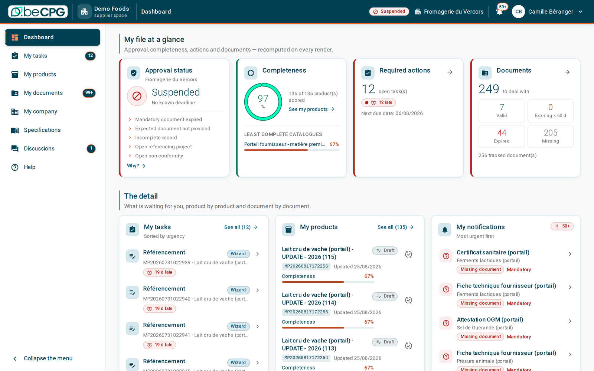
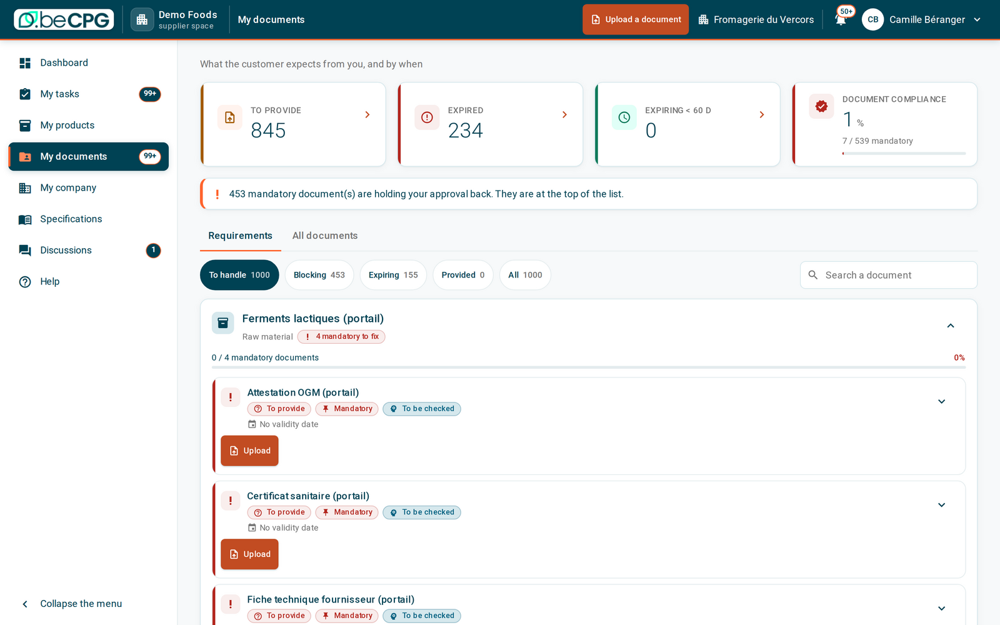
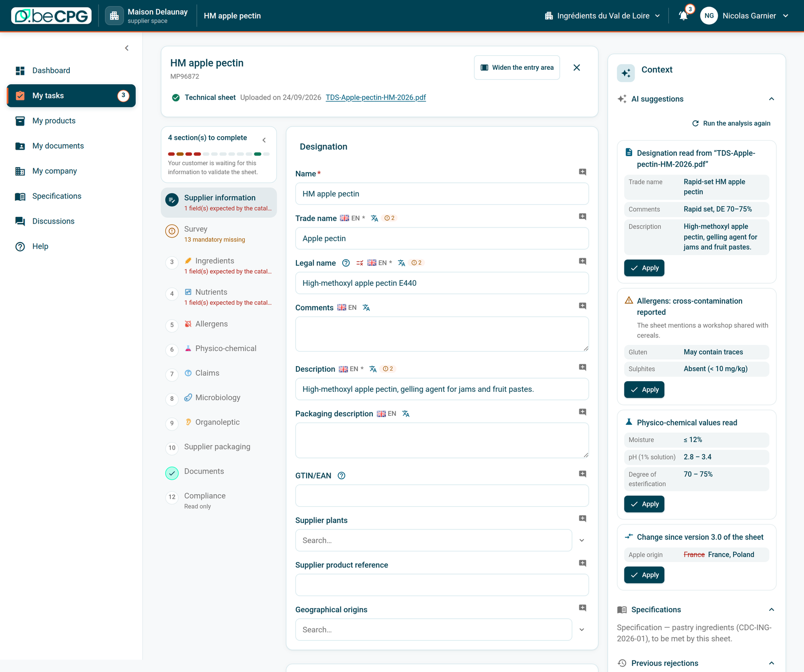
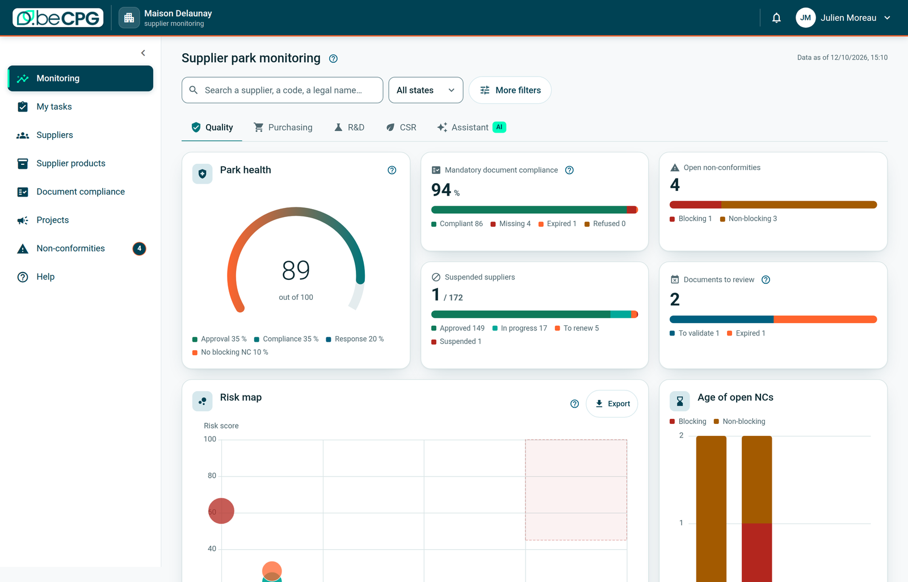
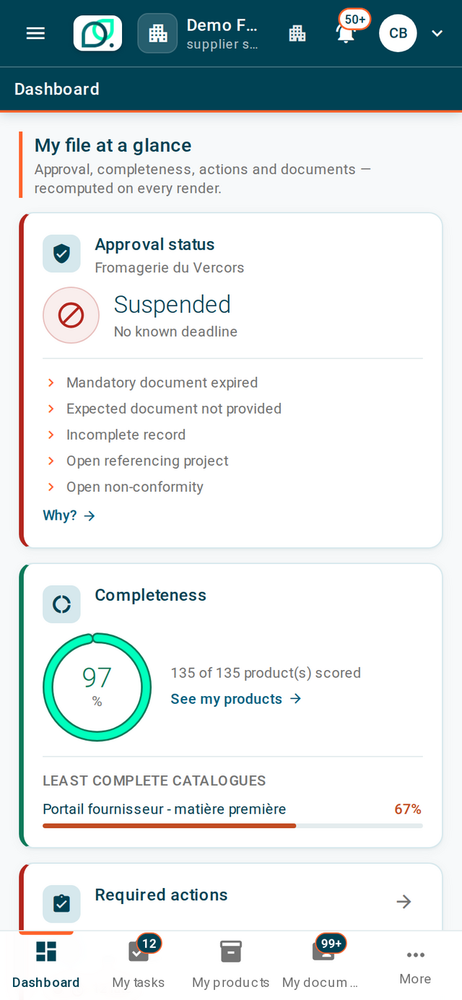
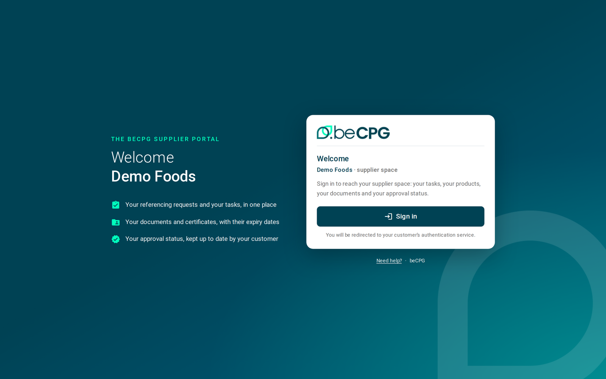

# beCPG Supplier Portal – Open Source Supplier Collaboration for beCPG PLM

[](https://www.gnu.org/licenses/lgpl-3.0)
[](https://nextjs.org/)
[](https://nodejs.org/)
[](https://github.com/becpg/becpg-supplier-portal/issues)
[](https://docs.becpg.fr)
[](https://www.becpg.net)

**Collect specifications, certificates and surveys from your suppliers — in their
language, on their phone, straight into your PLM. Open source, self-hosted, and driven by your
own PLM configuration.**

👉 [**Request a Live Demo**](https://www.becpg.net/community/) · [**Contact Us**](https://www.becpg.net/contact-us/) · [**Documentation**](https://docs.becpg.fr)



> 📸 **Screenshots taken from a demo instance.** Brand, supplier, product and people names are
> fictitious, and figures are demonstration data.

---

## 🚀 What is the beCPG Supplier Portal?

The **beCPG Supplier Portal** is the supplier-facing front end of
[**beCPG PLM**](https://github.com/becpg/becpg-community), the open-source PLM platform for the
Food, Beverage and Cosmetics industries.

Suppliers sign in with their own account and do the work a manufacturer needs from them:
onboarding surveys, product technical sheets, certificates and audit documents,
electronic signature of agreements. Quality and purchasing teams get a monitoring space showing,
at a glance, which supplier is compliant and which document is about to expire.

It is a **single Next.js application**: pages and route handlers in one runtime, no dedicated
Java back end. The portal proxies and composes the webscripts that beCPG PLM already exposes —
the same role Alfresco Share plays with `/share/proxy/alfresco`.

---

## 🖼 See it

### The supplier knows exactly what is expected, and by when

Every requirement your PLM declares becomes a line the supplier can act on: mandatory or not,
expired or expiring, with the upload button right there. No email thread, no shared drive.



### A guided wizard, driven by *your* configuration

Steps, fields, validations and lists come from the beCPG configuration cascade — the same one
that drives your internal forms, client overrides included. Nothing is hard-coded in the
portal, so a new field on your side is a new field in the portal, with no release.

Fields are multilingual out of the box (here English plus 34 other languages), and an optional
AI assist pre-fills the sheet from the technical document the supplier uploads — always with a
confidence level, never silently.



### Monitoring page for the Quality Team

Approval, document compliance, expiry horizon, supplier projects and non-conformities across the whole
supplier park — recomputed live from the repository, no OLAP cube required. When a figure
cannot be computed on the full park, the portal says so in the screen instead of quietly
publishing a number it cannot justify.



### Also designed to work on a phone



The portal is responsive down to **360 px**, with primary navigation in a bottom bar inside the
safe area — one-handed use, not a desktop layout squeezed onto a phone.

Accessibility is part of the review, not a later phase:

* status is **never conveyed by colour alone** — every status resolves to a
  (tone, icon, label) triple, readable in greyscale and by a screen reader;
* every interactive element is a real `<button>` / `<a>` / `<input>`, keyboard reachable, with a
  visible focus ring;
* no bare white page and no raw stack trace: every screen has a loading, empty and error state
  with a retry.

<br clear="right">

### Secure login for suppliers, with no extra password



One Keycloak realm per tenant, OIDC authorization-code flow, SSO if you have it. The supplier
never sees a portal-specific password, and the portal never stores one.

---

## 🌟 What it does

* **Supplier onboarding** – a guided wizard whose steps, fields and validations come from the
  PLM configuration, not from hard-coded forms; client-specific overrides are honoured.
* **Documents** – upload, renewal and expiry tracking of certificates, insurance policies and
  audit reports, with a per-document validity window.
* **Product technical sheets** – suppliers fill in specifications, composition and claims
  directly against the manufacturer's data model, in their own language.
* **Approval status** – derived on the fly from the repository, never persisted: no data model
  change, no state to keep in sync.
* **Electronic signature** – draw-to-sign agreements, signed documents are stored back in the
  PLM.
* **Monitoring space** – supplier park overview, supplier × document-type matrix, supplier projects and
  quality indicators, closed to supplier accounts.
* **AI-assisted capture** – optional, new in release 26.1. Values read from the technical sheet
  the supplier uploads are shown with a confidence level, and a missing confidence is never
  rendered as a low one. Nothing is saved without the supplier's confirmation. It covers:
  * suggestions on every step of the sheet, including values found for a step other than the
    one on screen;
  * allergen suggestions, cross-contamination included, served by beCPG's AI service;
  * document control: the type, the content and the validity dates of a certificate are
    checked, and the verdict can be contested;
  * comparison with the validated version, so a reviewer reads what changed, not the whole sheet.
* **Thirteen interface languages** – French, English (UK and US), German, Spanish, Italian,
  Brazilian Portuguese, Swedish, Finnish, Turkish, Japanese, Simplified Chinese and Arabic
  (right to left), picked from the supplier's beCPG profile; dates and numbers follow the language.

---

## 🥊 Why this rather than a proprietary supplier portal

Supplier collaboration is usually sold as a closed SaaS module, hosted by the vendor, with its
own data model to keep in sync with your PLM. This project takes the opposite position on each
of those points.

| | **beCPG Supplier Portal** | **Typical proprietary supplier portal** |
|---|---|---|
| **Licence** | LGPL-3.0-or-later, full source on GitHub | Closed source, annual subscription |
| **Running it yourself** | Yes — the community edition is this repository, one Docker image, no vendor hosting required | Vendor-hosted only |
| **Where your data lives** | In your own beCPG PLM, on your own infrastructure | In the vendor's cloud, exported on request |
| **Source of truth** | Forms, columns, lists and statuses come from *your* PLM configuration | A second data model to synchronise with your PLM |
| **Deployment** | One Docker image (standalone Next.js), Kubernetes-ready, air-gappable | Vendor-hosted, on the vendor's release calendar |
| **Identity** | Your OIDC provider, one realm per tenant, SSO | The vendor's account system |
| **A new field on your side** | Appears in the portal with no release — rendering is definition-driven | Usually a change request |
| **Extensibility** | Fork it, patch it, contribute back | Feature request queue |
| **Auditability** | Read the code that handles your suppliers' credentials | Trust the certification |

> The right-hand column describes the pattern common to the category, not any one product —
> always check a vendor's own terms. The left-hand column is verifiable in this repository:
> every claim maps to code you can read.

**And it is not a silo.** The portal is one Next.js application in front of the beCPG PLM you
already run: same repository, same permissions, same audit trail. What a supplier submits *is*
the PLM record — there is nothing to import afterwards.

---

## 🧩 Editions

| | **Community edition** | **Commercial edition** |
|---|---|---|
| **What it is** | This repository, released under LGPL-3.0-or-later | The same portal, run and supported by beCPG |
| **Hosting** | Yours: one Docker image, on your own infrastructure | Hosted by beCPG |
| **Support** | Community, through GitHub issues | Under your beCPG support agreement |
| **Cost** | No licence fee | See [becpg.net](https://www.becpg.net/contact-us/) |

The portal needs a beCPG PLM behind it in both cases. This README documents **release 26.1**;
the version of a running portal is reported by `/api/health`.

---

## 📚 Getting started

### Requirements

* **Node.js 22+** and npm
* A reachable **beCPG PLM** instance (Alfresco repository + Share)
* An **OIDC provider** (Keycloak / Alfresco Identity Service) for real authentication

### Run with Docker

```bash
cp env.example .env      # fill OIDC_CLIENT_SECRET and SESSION_COOKIE_SECRET
docker compose up --build
curl -s http://localhost:3000/api/health     # {"status":"ok","version":"..."}
```

### Run from source

```bash
npm install
npm run dev              # http://localhost:3000, reads ./.env
```

Point `BECPG_URL` at your repository and `BECPG_SHARE_URL` at your Share instance. Both must be
set explicitly: Next.js loads `.env` **in addition to** any environment file you source, so a
half-configured environment silently mixes the data of one instance with the configuration of
another — and renders a wizard with zero fields, with nothing in the logs.

Without an OIDC provider, set `DEV_FAKE_AUTH=true` to authenticate straight against the
repository with `BECPG_DEV_USER` / `BECPG_DEV_PASSWORD`. It writes exactly the same encrypted
session cookie, and **refuses to run when `NODE_ENV=production`**.

### Other commands

```bash
npm run build            # standalone output, used by the Docker image
npm start
npm run lint             # eslint .
npm run licenses         # regenerate THIRD-PARTY-LICENSES.md from node_modules
```

---

## ⚙️ Configuration

Every environment variable is documented in [`env.example`](./env.example) — without exception,
that is a project rule.

| Group | Variables |
|---|---|
| OIDC | `OIDC_ISSUER_TEMPLATE`, `OIDC_ISSUER_HOSTS`, `OIDC_ISSUER_BASE`, `OIDC_CLIENT_ID`, `OIDC_CLIENT_SECRET`, `PORTAL_BASE_URL`, `OIDC_SCOPES`, `OIDC_CLOCK_TOLERANCE`, `OIDC_ISSUER`, `OIDC_REALM` |
| Session | `SESSION_COOKIE_SECRET`, `SESSION_COOKIE_NAME`, `SESSION_TTL`, `SESSION_COOKIE_SECURE` |
| Multitenant | `DEFAULT_TENANT`, `TENANT_MAP`, `TENANT_HOST_SUFFIX`, `BECPG_INSTANCE` |
| beCPG | `BECPG_URL`, `BECPG_TIMEOUT`, `BECPG_TICKET_TTL` |
| Share (wizard configuration) | `BECPG_SHARE_URL`, `BECPG_SHARE_WIZARD_ENDPOINT` |
| Portal | `PORTAL_TEST_MODE`, `PORTAL_DEFAULT_LANG`, `PORTAL_EXPIRY_NOTICE_DAYS`, `PORTAL_APPROVAL_CACHE_TTL`, `PORTAL_DEBUG` |
| Build | `PORTAL_VERSION` (stamped by the image, served by `/api/health`) |
| Development only | `DEV_FAKE_AUTH`, `BECPG_DEV_USER`, `BECPG_DEV_PASSWORD`, `BECPG_TICKET`, `BECPG_TICKET_MODE` |

**No secret is ever exposed to the browser**: there is no `NEXT_PUBLIC_*` variable at all, by
design, and no OIDC configuration on the client side.

---

## 🏗 Architecture and security

How it is built, why authentication stays on the server, and the three rules that keep an
Alfresco ticket out of the browser: [`doc/architecture.md`](./doc/architecture.md).

The webscripts the portal consumes, and the traps they hide:
[`doc/becpg-api-contracts.md`](./doc/becpg-api-contracts.md).

---

## 📁 Repository layout

```
app/                      App Router
  layout.js               root layout (font, language cookie, providers)
  error.js                render boundary — retry + digest, never the message
  globals.css             Tailwind 4, utilities, :focus-visible baseline
  page.js                 supplier dashboard
  login/ company/ documents/ messages/ products/[id]/ specs/ tasks/[id]/ help/
  monitor/                monitoring space — layout.js holds the access gate
  share/page/wizard/      entry point from Share
  api/                    THE proxy — route handlers
    health/route.js       { status, version } — Docker HEALTHCHECK and k8s probes
    auth/                 login, callback, logout, session (OIDC code flow)
    v1/                   internal API, incl. monitor/*
components/               React components (Tailwind only, no UI kit)
  ui/ shell/ form/ datalist/ wizard/ monitor/ documents/ dashboard/ signature/
lib/                      session, beCPG proxy, errors, tenant
  adapters/               one adapter per business domain
config/                   chrome messages, default wizards
doc/                      architecture.md, becpg-api-contracts.md, images/
proxy.js                  nothing is reachable without a session; resolves the tenant
```

---

## 🤝 Community & contributing

Contributions are welcome. Before touching a file, read [`AGENTS.md`](./AGENTS.md): it carries
the non-negotiable rules of this codebase (JavaScript only, no UI kit, no i18n library,
server-side authentication, accessibility baseline) and the conventions we review against.

* [Contributing Guidelines](CONTRIBUTING.md)
* [Code of Conduct](CODE_OF_CONDUCT.md)
* [Security Policy](SECURITY.md)

---

## 📄 License

Licensed under the **GNU Lesser General Public License v3.0 or later** — see [LICENSE](LICENSE)
and [NOTICE](NOTICE). Third-party dependencies are listed in
[THIRD-PARTY-LICENSES.md](THIRD-PARTY-LICENSES.md).

---

## 📩 Contact

* 🌐 [Website](https://www.becpg.net)
* 📖 [Documentation](https://docs.becpg.fr)
* 🎮 [Live Demo](https://www.becpg.net/community/)
* ✉️ [Contact Us](https://www.becpg.net/contact-us/)

---

⚡ **beCPG – Accelerate innovation, stay compliant, and reduce PLM costs for CPG companies.**
